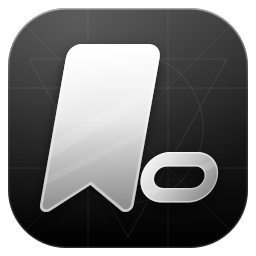
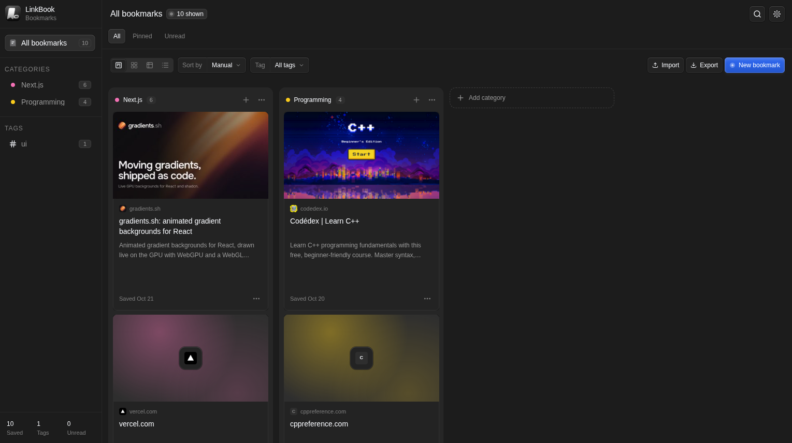
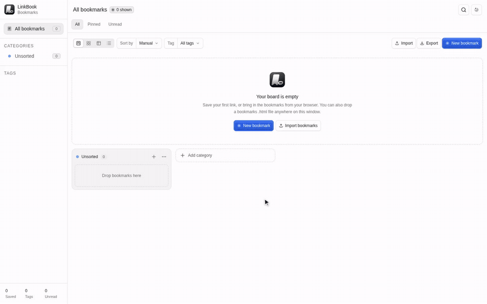
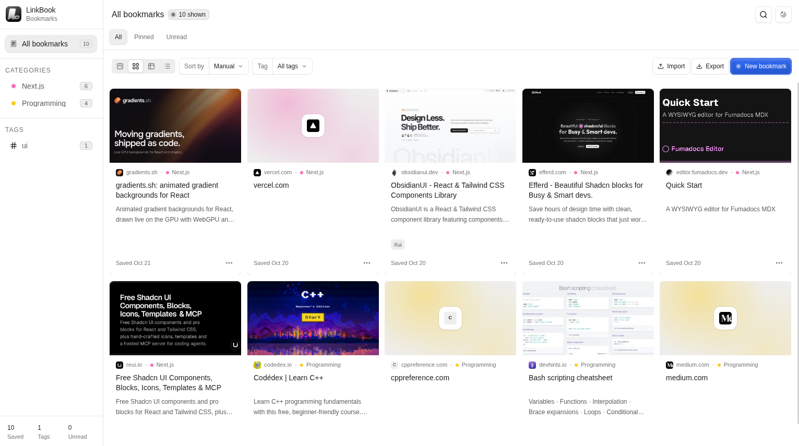
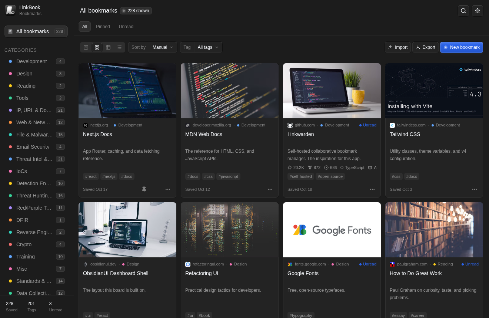
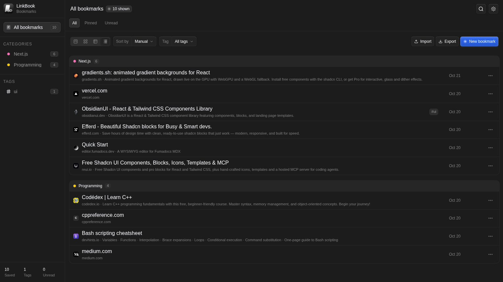

<div align="center">
  
  <h1>LinkBook</h1>
  <h3>A free and open-source alternative to Linkwarden for Linux</h3>


<a href="LICENSE"></a>

</div>

<div align='center'>

[Features](#features) · [Install](#install) · [Import your bookmarks](#import-your-bookmarks) · [Shortcuts](#keyboard-shortcuts) · [Development](#development)



</div>

## Intro & motivation

**LinkBook is a desktop bookmark manager for Linux to collect, organize, and browse the links that matter, all in one window.**

LinkBook brings that experience to the desktop. Bookmarks live in categories and tags, and every link gets its title, description, and preview image filled in automatically. Links to GitHub repositories show their stars, forks, language, and last push. You can look at your library as a kanban board, a grid of cards, a sortable table, or a compact list.

## Features

- 🗂️ Four views of the same library: **Board** (kanban), **Grid**, **Table**, and **List**
- 🖱️ Drag bookmarks between category columns to reorganize them
- ✨ Paste a link and its title, description, and preview image fill in automatically
- 🐙 GitHub repository links show stars, forks, open issues, language, license, and last push
- 📂 Organize by category and multiple tags, with pinned and unread bookmarks
- 🔍 Search by title, URL, description, or tag; filter by tag; sort by date or title
- ⬆️ Import any browser's bookmarks export (Chrome, Firefox, Edge, Brave, Safari), from the Import button or by dropping the file on the window
- ⬇️ Export your whole library as a standard bookmarks HTML file, readable by every browser
- 🌓 Light and dark mode, following your system theme by default
- ⌨️ Native menus and keyboard shortcuts for everything you do often.

## In action

<div align="center">
  
</div>

## Screenshots

<div align="center">
  
  
  
</div>

## Install

Download the latest build from the [Releases page](https://github.com/0x0f2Root/LinkBook/releases). All packages are for x86-64 Linux:

| Package | For | Install |
|---|---|---|
| `.deb` | Debian, Ubuntu, Mint, Pop!_OS, and derivatives | `sudo apt install ./linkbook_*_amd64.deb` |
| `.AppImage` | Almost any distribution, no install | `chmod +x LinkBook-*.AppImage && ./LinkBook-*.AppImage` |
| `.zip` | A portable folder | unzip, then run `./LinkBook-linux-x64/linkbook` |

The `.deb` adds LinkBook to your applications menu under **Utility** and a `linkbook` command. Opening it again while it's running brings the existing window forward. Each release includes a `SHA256SUMS` file to check your download with `sha256sum -c SHA256SUMS --ignore-missing`.

To remove the `.deb`:

```bash
sudo apt remove linkbook
```

Removing the package keeps your bookmarks in `~/.config/LinkBook`. Delete that folder to remove them too.

### Build from source

```bash
pnpm install
pnpm make          # .deb, AppImage, and .zip in out/make/
```

## Import your bookmarks

1. In your browser, export your bookmarks as an HTML file (Chrome and Edge: *Bookmark manager → ⋮ → Export bookmarks*; Firefox: *Library → Import and Backup → Export Bookmarks to HTML*).
2. In LinkBook, click **Import** (or press Ctrl+O), or drop the file onto the window.

Folders become categories, tags and dates are kept, and links you already have are skipped. You can undo an import right after it finishes. To move bookmarks the other way, **Export** (Ctrl+Shift+E) writes the same format.

## Keyboard shortcuts

| Shortcut | Action |
|---|---|
| Ctrl+N | New bookmark |
| Ctrl+O | Import bookmarks |
| Ctrl+Shift+E | Export bookmarks |
| Ctrl+F | Search |
| Ctrl+1 … Ctrl+4 | Board, Grid, Table, List |
| Ctrl+Shift+L | Toggle dark theme |
| Ctrl+Q | Quit |

## Like LinkBook? Give it a star ⭐

Starring the repository and telling a friend who's tired of browser bookmarks are the best ways to help.

## Suggestions & roadmap

Ideas and bug reports are welcome as issues in the repository. Things that would make LinkBook better, roughly in order:

- Page archives (screenshot and PDF), like Linkwarden's, to protect against link rot
- Bulk actions: select several bookmarks to move, tag, or delete
- More package formats: AppImage, Flatpak, and `.rpm`
- Optional sync between computers

These are ideas, not promises.

## Development

Requirements: Node.js 22.13 or newer, pnpm 10 or newer, and `dpkg`, `dpkg-deb`, and `fakeroot` for packaging.

```bash
pnpm install          # dependencies; Electron downloads its binary on first use
pnpm start            # run with hot reload
pnpm package          # packaged app in out/LinkBook-linux-x64/
pnpm make:deb         # the installer in out/make/deb/x64/
pnpm check            # typecheck, lint, and unit tests
pnpm test:e2e         # end-to-end tests against the packaged app (run pnpm package first)
pnpm demo:record      # re-record the demo GIF in assets/demo/ (run pnpm package first)
```

`pnpm test:e2e` opens and closes LinkBook windows for about ten seconds, using a throwaway profile with the network off. Set `LINKBOOK_BINARY=/usr/bin/linkbook` to test an installed copy.

```
src/main/        Electron main process: window, menu, storage, link previews, images, GitHub stats
src/preload/     the small, typed bridge the window uses to reach the main process
src/shared/      the contract between the two: channels, types, and input validation
src/renderer/    the window's entry point
src/components/  the interface: board, cards, views, forms, and the ObsidianUI shell
src/lib/         bookmarks, import and export, GitHub helpers
tests/           unit tests (Vitest) and end-to-end tests (Playwright over DevTools)
```

## License

LinkBook is free and open source under the [MIT License](LICENSE). You can use, copy, modify, and share it, including in commercial projects, as long as the copyright notice and license text come along.

## Thanks

LinkBook stands on the work of others:

- [Linkwarden](https://github.com/linkwarden/linkwarden), the inspiration for the whole idea
- [ObsidianUI](https://www.obsidianui.dev), for the dashboard shell the interface is built on
- [Electron](https://www.electronjs.org), [Electron Forge](https://www.electronforge.io), [Vite](https://vite.dev), [React](https://react.dev), [Tailwind CSS](https://tailwindcss.com), [Radix](https://www.radix-ui.com), [Motion](https://motion.dev), [Lucide](https://lucide.dev), and Duo Icons
